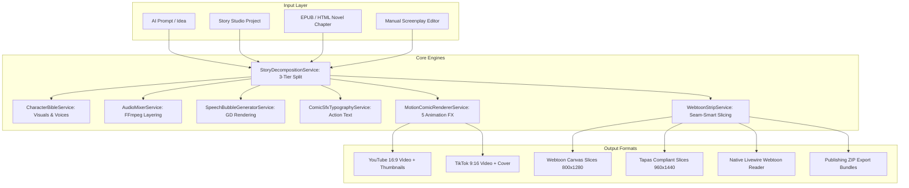

# Master Content Factory & ComicStudio Blueprint

A comprehensive, production-ready blueprint for an automated content generation studio powering high-retention video and comic publishing pipelines for YouTube, TikTok, Webtoon Canvas, Tapas, and independent gated websites.

---

## 1. System Vision & Architecture

The system transforms raw stories, novels, EPUBs, and AI concepts into serialized multimedia assets across three core monetization verticals:
1. **Long-Form Video (YouTube Widescreen 16:9)**: 8–15 minute monetizable episodes with high watch time, mid-roll ad optimization, and layered audio.
2. **Short-Form Video (TikTok & YouTube Shorts 9:16)**: 60–90 second viral hook-and-cliffhanger clips funneling traffic to full episodes and affiliate links.
3. **Vertical-Scroll Webtoons (Tapas, Webtoon Canvas, Self-Hosted)**: Continuous vertical image strips, segmented into platform-compliant slices (800×1280px, <2MB) with reader modes and ZIP export packs.

---

## 2. Phased Roadmap

| Phase | Title | Core Deliverables | Status |
|---|---|---|---|
| **Phase 1** | **Motion Comic Video Engine** | • 5 Animation Movements: Ken Burns, Parallax, Slide-In, Camera Shake, Impact Frame • Layered Audio: Voice + BGM + SFX + Ambient via FFmpeg • Speech Bubbles: Manga, Webtoon, and Caption Box • Character Bible System with AI Profile Generator • 6 Content Factory Presets ($7–$18 RPM) | ✅ **Completed & Verified** |
| **Phase 2** | **Webtoon Strip Engine & Publisher** | • Vertical-Scroll Continuous Strip Stitching • Smart Seam Slicing (800×1280px, <2MB for Webtoon Canvas) • On-Screen Comic SFX Typography ("BOOOM!", "SLASH!") • 1-Click Story & EPUB Novel to Comic Converter • Native Livewire Webtoon Reader & ZIP Exporter | ✅ **Completed & Verified** |
| **Phase 3** | **Traditional Manga Page-Spread & PDF/CBZ Exporter** | • Multi-Panel Page Layout Generation (Auto Flow, Full Splash, Wide Half, Small Cell) • RTL / LTR Japanese Reading Order Flow • E-Reader CBZ Comic Archive Exporter • Native Livewire Manga Reader with Double-Spread & Fullscreen • Printable / Digital Publishing Standards | ✅ **Completed & Verified** |
| **Phase 4** | **Interactive Visual Panel Director & Timeline Canvas** | • 2D Interactive Panel Canvas with Click-to-Position Bubbles & SFX • Percentage Coordinate Math (`x_pct`, `y_pct` 5–95% safe zones) • Dynamic Camera Keyframing (`camera_keyframes` timeline) • Mathematical Zoompan & Shake Compilation in FFmpeg • Real-time Livewire Panel Director Modal | ✅ **Completed & Verified** |
| **Phase 5** | **Multi-Actor Voice Acting & Emotion TTS** | • Dual Voice Delivery Modes: `multi_actor` (Full Audio Drama) vs `solo_narrator` (Pure Prose Recap) • Per-character voice resolution from Character Bible • 7 Acoustic Emotion Modulations (neutral, intense, shouting, whisper, sorrow, joy, terrified) • Multi-actor dialogue timeline concatenation with breathing pauses • Synchronized WebVTT subtitle generation with actor voice tags • Livewire Audio Drama Player, Mode Toggle Switch & Episode Voice Batching | ✅ **Completed & Verified** |
| **Phase 6** | **AI Character Consistency & Prompt Matrix** | • Reference sheet locking & face consistency • Style presets matrix across 50+ episode arcs | ⏳ *Next Planned* |
| **Phase 7** | **Commercial Automation & Multi-Platform Publisher** | • Scheduled social publishing webhooks (YouTube Studio, TikTok Content API) • Analytics and watch-time retention dashboard | ⏳ *Planned* |

---

## 3. Database Architecture

### Entity-Relationship Model
- **`content_titles`**: Overarching show or franchise title containing visual styles, aspect ratio, color palettes, and default narrator voice.
- **`characters`**: Recurring character sheets with names, avatars, age, gender, role (`protagonist`, `antagonist`, `supporting`), TTS `voice_id`, `color_theme`, and image consistency tokens.
- **`stories`**: Arcs or volumes under a title.
- **`episodes`**: Individual chapters/episodes with narration scripts, video paths, webtoon strip paths, and export pack paths.
- **`scenes`**: Narrative scenes specifying setting, mood, and location.
- **`scene_boards`**: Individual comic panels containing art prompt, speech bubbles, animation movement, SFX typography, and gutter spacing.
- **`audio_mixes`**: Audio tracks attached to scene boards (`bgm`, `sfx`, `ambient`, `voice`) with volume, offset, and fading.
- **`content_factory_templates`**: Seeded industry-standard presets with estimated RPM, target platforms, and art direction parameters.

---

## 4. Services Specification

### 4.1. `SpeechBubbleGeneratorService`
- **Engine**: PHP GD with TrueType font fallbacks.
- **Styles**:
  - `manga`: Bold black outer border, white interior ellipse, dynamic pointer tail.
  - `webtoon`: Rounded rectangle with indigo accent border, character name badge.
  - `caption_box`: Semi-transparent obsidian frame with double gold borders for novel narrations.
- **Positioning**: Automatic quadrant calculation (`top-right`, `top-left`, `bottom-right`, `bottom-left`, `center`) with dynamic text wrapping.

### 4.2. `AudioMixerService`
- **Engine**: FFmpeg `amix` multi-channel filter.
- **Volume Ratios**:
  - Primary voice narration: `1.0` (100% volume, unaltered).
  - Background music (BGM): `0.18–0.25` (ducked underneath voice, looped seamlessly with `aloop`).
  - Sound effect hits (SFX): `0.70` (timed to panel attack).
- **Auto-Presets**: Maps `action`, `romance`, `suspense`, `horror`, `calm` moods to designated royalty-free audio files.

### 4.3. `MotionComicRendererService`
- **Animation Filters**:
  - `ken_burns`: `zoompan=z='min(zoom+0.0014,1.20)'` (alternating zoom directions).
  - `parallax`: Diagonal floating drift simulating foreground/background depth.
  - `slide_in`: Horizontal entry with smooth easing curves.
  - `camera_shake`: High-frequency sinusoidal translations (`sin(2*PI*on/4)*12`) for impact beats.
  - `impact_frame`: Fast zoom explosion (1.25x scale) with flash transition.
- **Atmospheric Particles**: Noise and color grading overlays for `rain`, `snow`, `sparks`, `fire_embers`, `dust`.

### 4.4. `WebtoonStripService`
- **Stitching**: Reads board images in sequence, calculates vertical dimensions with customizable gutters (default 80px), and renders a seamless vertical strip.
- **Seam-Smart Slicing**: Slices the vertical strip into 800px × 1280px segments. Analyzes inter-panel gutters to place seam cuts exclusively in empty whitespace, ensuring no cuts through dialogue bubbles or faces.
- **Compression**: Produces optimized JPEGs and WebPs strictly below 2MB per slice for direct Webtoon Canvas compatibility.

### 4.5. `ComicSfxTypographyService`
- **Rendering**: Generates on-panel action lettering (`"BOOOOM!!"`, `"SLASH!!"`, `"THUD!!"`, `"SWOOSH!"`).
- **Typography Styles**: Speedline extrusion, italicized angular rotation (-25° to +25°), dual-stroke contrasting outlines.

### 4.6. `StoryToComicConverterService`
- **Conversion Engine**: Transcribes prose from `StoryStudio` or chapters from `EpubStudio`.
- **Dialogue Extractor**: Leverages Gemini 2.5 Flash to identify spoken dialogue, determine the speaking character from the Character Bible, and structure it into `speech_bubbles` JSON.

---

## 5. Platform Export Standards

| Platform | Dimension Constraints | Format | Max File Size | Extra Assets |
|---|---|---|---|---|
| **Webtoon Canvas** | Exactly 800px width, max 1280px height per slice | JPG / PNG | 2 MB per image | Square Thumbnail (436×436px) |
| **Tapas** | Max 960px width, max 1440px height per slice | JPG / PNG | 2 MB per image | Square Thumbnail (300×300px), Banner (960×450px) |
| **YouTube** | 1920×1080 (16:9), 25–30 FPS | MP4 (H.264 / AAC) | — | Thumbnail (1280×720px) |
| **TikTok / Shorts** | 1080×1920 (9:16), 25–30 FPS | MP4 (H.264 / AAC) | — | Cover Frame (720×1280px) |

---

## 6. Verification & Quality Gates

Every component follows test-driven development with Pest:
- **Unit Testing**: Isolated service tests with mocked or synthetic inputs (e.g. GD image rendering, audio mix parameter validation).
- **Feature Testing**: Livewire component workflows, database assertions, queue job dispatches.
- **Code Standards**: Formatted via Laravel Pint (`vendor/bin/pint --format agent`).
